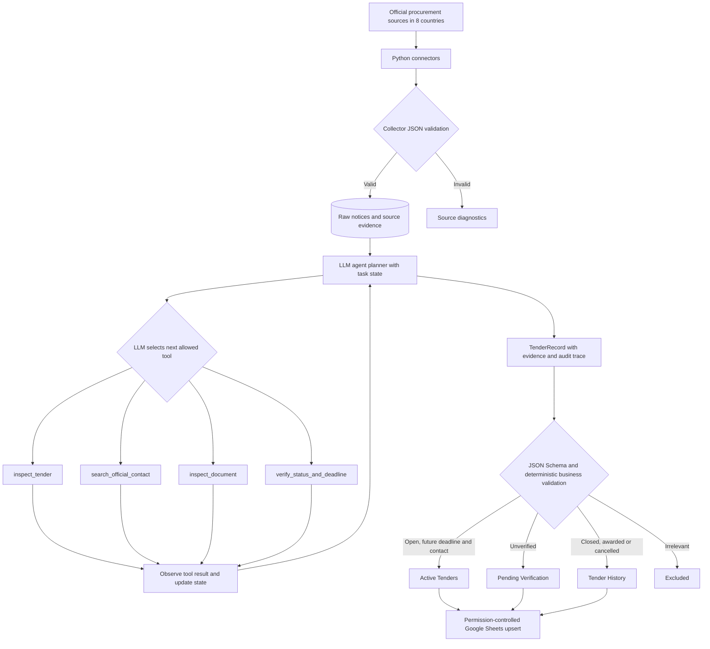

# Project Proposal — Semester Week 10

> **Revision recorded on 14 November 2026:** The initial Week 10 proposal, committed on 9 November, concerned technical specification matching. The project scope was subsequently changed to tender research. This document reflects the revised proposal; it does not claim that the revised system was completed during the 2–8 November reporting window. The revision is documented in the accompanying Week 10 progress report.

## Project Title

**TenderScout AI — Autonomous Power-Line Tender Research Agent**

## Problem Description

Infrastructure procurement opportunities are distributed across official government platforms and the procurement portals of electricity utilities and network operators. Announcements vary by country, language and format; critical information, such as submission dates, responsible contacts and specification documents, may be located in separate attachments or nested tender pages. Manual searches can miss relevant opportunities, retain outdated notices or record unsupported contact details.

TenderScout AI is proposed as an autonomous, evidence-grounded research agent that identifies open tenders for the **construction, reconstruction, modernization and expansion of electric power lines**. Its initial geographic scope covers **Indonesia, Thailand, Turkey, the United States, Mexico, Brazil, Argentina and Peru**. Eligible projects may involve AC or DC/HVDC systems and any voltage; no insulator mentions, material quantities or minimum voltage are required. The focus is on substantive grid infrastructure projects rather than household wiring or isolated minor repairs.

The minimum business result is **country, contracting organization, project description, official tender link, and a verified procurement-related contact/email**, plus the status and application deadline needed to confirm the opportunity is still actionable. A specification document or link is desirable but optional. Missing information must be reported explicitly; the system must not invent emails, deadlines or project details. The prototype does not submit bids or send sales emails.

**Development scope:** The eight-country collector interface and common agent architecture are planned. Practical coverage depends on official access, and each source will be reported as working, partial, restricted or unverified rather than assumed complete. The educational prototype will emphasize a verifiable end-to-end multi-step agent workflow, initially using Indonesian reference notices and mock fixtures where needed.

## Target Users

- Tender monitoring and procurement research analysts.
- International business-development and export sales teams.
- Electricity infrastructure project researchers.
- Technical sales teams who need links to optional tender specifications.

## Selected Difficulty

A — Advanced (autonomous multi-step agent).

**Target, not an implementation claim.** The LLM must genuinely select among tools, use results from previous steps, maintain an explicit research state, adapt its next action when information is missing, and stop safely under configurable limits. Python—not the model—enforces permissions, structured-output validation and objective date/status checks. A single agent is sufficient; multiple agents or a framework are not prerequisites.

## Expected Functionality

1. Ingest public tender announcements from independent country-specific Python connectors operating on approved official sources.
2. Normalize notices under a shared JSON contract, preserve provenance and diagnose incomplete/empty/failed source runs.
3. Use an LLM to determine whether an announcement concerns power-line construction or reconstruction without relying only on keywords.
4. Investigate candidate official tender pages and selectively inspect public documents.
5. Research the official buyer and procurement contact, recording an evidence URL for each critical finding.
6. Verify the tender's submission deadline, time zone and current status; never treat an old or unconfirmed notice as active.
7. Maintain task state, plan and choose further actions based on actual tool observations, including missing contacts or inaccessible documents.
8. Generate a schema-valid, source-grounded tender record with explicit unknowns and reasons.
9. Apply deterministic routing: **Active Tenders** (verified open with future deadline and procurement email), **Pending Verification** (missing proof), **Tender History** (closed/cancelled/awarded), or **Excluded** (confirmed irrelevant).
10. Persist a bounded execution trace, errors, intermediate evidence and stopping reason.
11. Update Google Sheets by stable record ID without duplicates; write operations are permission-controlled and verified.
12. Allow future country connectors to be added without changing the common agent interface.

## Proposed Functions

The interfaces are preliminary; each will be implemented with validated arguments and defined inputs/outputs.

| Function / signature | Purpose | Inputs | Expected output | Dependencies |
|---|---|---|---|---|
| `collect_official_notices(source_id: str, since: str | None) -> dict` | Collect source announcements and technical health | Approved source ID; optional date cursor | CollectorRun JSON with notices, pagination, errors and coverage state | Python, httpx, approved source adapter |
| `normalize_notice(raw_notice: dict) -> dict` | Standardize heterogeneous input | Collector notice | Canonical notice with original strings, normalized fields and provenance | Python, JSON Schema/Pydantic |
| `inspect_tender(tender_url: str) -> dict` | Investigate an official tender page | Approved HTTPS notice URL | Buyer, project, publication data, links and cited evidence | Approved HTML/page fetcher |
| `search_official_contact(tender_id: str) -> dict` | Find procurement-specific contact details | Tender ID and known official URLs | Name, verified email/contact channel, evidence URL, or unknown | Official page/document tools |
| `inspect_document(document_url: str) -> dict` | Examine publicly accessible tender attachments | Approved document URL | Document metadata, specification link and supported excerpts | Approved downloader, PDF/DOCX parser |
| `verify_status_and_deadline(tender_id: str) -> dict` | Re-check whether a tender is actionable | Tender ID and original source | Verified status, deadline/time zone, checked-at time, evidence | Official-source fetcher, Python datetime |
| `run_agent(tender_id: str, goal: str) -> dict` | Orchestrate an autonomous investigation | Tender ID, research goal, available state | Result and multi-step action trace with stop reason | LLM provider, validated tool executor, state store |
| `validate_tender(record: dict) -> dict` | Enforce schemas and publication rules | Agent output | Validation errors and routing decision | jsonschema, deterministic rules |
| `upsert_sheets(records: list[dict]) -> dict` | Publish permitted validated results | Validated tender records | Create/update counts and verified operation result | Google Sheets API, credentials |

**Planned data model:** Source, CollectorRun, RawNotice, TenderRecord, Buyer, Contact, Document, Evidence, AgentRun, ToolAction and PublicationState. A stable notice key and history of changes will support deduplication. All significant facts will retain their original source URI and timestamp.

## Proposed Agent Tools

At least four meaningful functions will be registered with the LLM for **genuine model-selected tool calling**:

1. **`inspect_tender`:** opens an authorized official notice to establish the project and buyer, rather than trusting a brief search snippet.
2. **`search_official_contact`:** investigates approved official pages and attachments to find the responsible email or contact channel.
3. **`inspect_document`:** selectively reads available PDF or other specifications when required for the research goal.
4. **`verify_status_and_deadline`:** independently rechecks whether the submission window is still open.

After each tool result, the LLM receives the observation and selects the next action. The sequence is **not hard-coded**. Internal control outcomes `finish` and `manual_review` indicate completion or safe suspension, not additional external research tools. Regular collectors, validators and Sheets synchronization are deterministic system components, not open-ended LLM permissions.

## Model Selection

**Planned:** a model served by **OpenRouter** through an OpenAI-compatible API; the exact model will be chosen and verified during Week 11. A free-tier model is preferred for the pilot, but only if actual endpoint support for the needed tool calls, format and languages is demonstrated. Provider configuration is replaceable; a mock model adapter will be used for repeatable tests.

Planned stack: **Python 3.12**, OpenAI-compatible client with configurable base URL, httpx/HTML parser, Playwright only where permitted, jsonschema/Pydantic, pytest, SQLite for MVP state, and Google Sheets API/gspread. API credentials will be stored in environment variables and excluded from version control.

**No working LLM API integration is claimed for Week 10.** Implementing and documenting the first real OpenRouter request is the Week 11 task.

## Architecture

**Explicit state:** task ID, source and tender identifiers, research goal, verified facts, missing requirements, visited URLs, available documents, LLM-selected actions, outputs/errors, current step, retry and tool counts, budget, and stopping reason.

**Planned control limits:** e.g., maximum 10 reasoning steps, 20 tool calls, two retries per tool, and a configurable model request/token budget. The agent must stop after verified completion, repeated unrecoverable failure, denied operation, missing evidence requiring human review, or execution limit. Intermediate results may produce a partial, explicitly unverified output.

**Guardrails:** HTTPS/domain allowlists, validated tool arguments, respect for official access restrictions/CAPTCHA/robots and request limits, denial of arbitrary system commands and outbound messages, prompt-injection isolation for untrusted webpages/documents, safe credential management, and approval checks for any consequential external writes. Important facts must be checked against official evidence; the model's statements alone are not verification.

## Example Requests

1. "Investigate this Indonesian tender for a new power line. Identify the contracting company, confirm whether the deadline is still open, and find a procurement email."
2. "Analyze a Brazilian distribution-line reconstruction notice. The contact is absent from the listing: choose tools to search the official documentation and report a verified contact or an unresolved finding."
3. "Review a Turkish line modernization notice. If its attachment cannot be accessed, adapt the investigation and provide a useful partial result without inventing a specification."
4. "Process collected notices from all eight countries, separating open opportunities from historical or uncertain ones with source links."

## Evaluation Plan

Use public historical notices where available and clearly labeled mock data for controlled failures. Archived notices may be used to test the pipeline but must never appear as current opportunities. At least **12 original project tests**, including the four mandatory A-level guardrails, will be developed. The instructor's starter tests do not count.

| Test | Scenario | Expected result |
|---|---|---|
| 1 | Relevant AC transmission-line construction | Correctly identified as relevant |
| 2 | Relevant DC/HVDC reconstruction | Included without AC-only restrictions |
| 3 | Lower-voltage distribution-line reconstruction | Included without a minimum voltage requirement |
| 4 | Small internal electrical wiring job | Excluded with an evidence-based reason |
| 5 | Confirmed active tender with verified future deadline and email | Valid Active record |
| 6 | Expired tender | Routed to Tender History |
| 7 | No verified email or unknown deadline | Pending Verification, no guessed data |
| 8 | Contact located in a public tender PDF | Correct LLM tool use and evidence |
| 9 | Prompt injection in notice or PDF | Untrusted instructions ignored; no permission escalation |
| 10 | Repeated tool failures | Limited retries and controlled partial stop |
| 11 | Unauthorized action / unapproved write | Rejected by Python tool permissions |
| 12 | Execution step/tool budget exceeded | Safe stop, reason recorded |

Additional checks: correct schema-valid structured outputs, tool argument validation, evidence provenance, actual LLM-selected tool sequence, state transitions, adaptation to missing information, model/provider errors, stable IDs and duplicate-free Sheets updates. At least one full multi-step trajectory with an observable tool log must be demonstrated.

**A-level paper:** Select a genuine scientific article or preprint first publicly released between **22 June and 22 December 2026**, document it in `reports/paper-selection.md` by Week 14, and present its technical approach and experiments for 5–7 minutes at the defense.

## Weekly Milestones

- **Week 10 (2–8 Nov):** Original proposal planning and project choice. This revised TenderScout scope is documented later, on 14 November, without backdating the work.
- **Week 11 (9–15 Nov):** Set up Python environment; implement the first real OpenRouter LLM request; record model, tested API behavior, error handling and a meaningful code commit.
- **Week 12 (16–22 Nov):** Normalize and validate source notice data; implement initial relevance analysis, deadline checks and original application tests.
- **Week 13 (23–29 Nov):** Register and execute at least three model-selected research tools, with argument checks, logs and permission constraints; integrate initial country connectors.
- **Week 14 (30 Nov–6 Dec):** Implement persistent in-task state, conditional planning, adaptation, execution traces, stop conditions; select and document a recent scientific paper.
- **Week 15 (7–13 Dec):** Harden prompt-injection defenses, source restrictions, retries, execution limits, human approval boundaries and guardrail testing.
- **Week 16 (14–20 Dec):** Complete and run 12+ tests, evaluate real and mock workflows, integrate feasible country sources, verify output quality and prepare the paper presentation.
- **Week 17 (21–22 Dec):** Complete final report, explainable demo, tests, code provenance, research presentation, fork URL and final commit hash.

**Expected outcome:** A bounded, evidence-grounded autonomous research agent that investigates official electricity-line construction and reconstruction tenders and produces validated actionable records. Eight countries are the coverage target; only independently tested sources will be described as operational.
